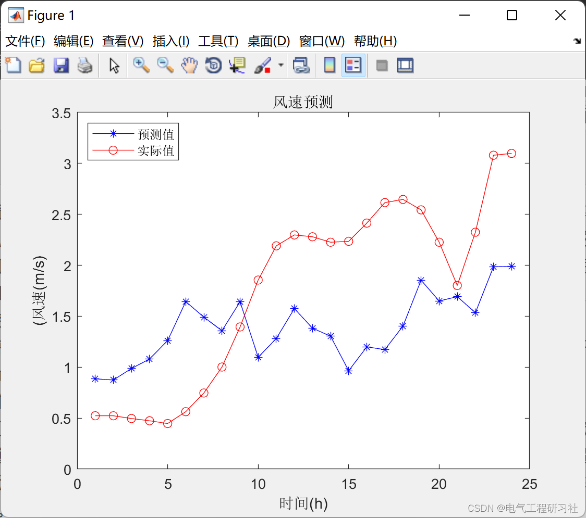
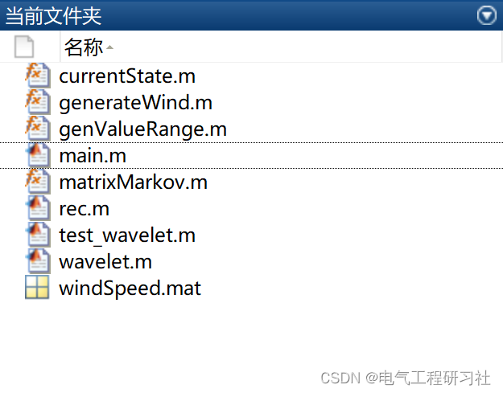

# Short-term Wind Power Forecasting (Matlab Code Implementation)

​  
📋📋📋 This article's table of contents is as follows: ⛳️⛳️⛳️​Table of Contents 1. Overview 2. Run Results 3. MATLAB Code Implementation 4. Final Thoughts
To further enhance the prediction accuracy of the model, this paper also improves the Particle Swarm Optimization (PSO) algorithm from a quantum mechanics perspective. It introduces the Quantum Particle Swarm Optimization (QPSO) optimization algorithm, an adaptive premature termination criterion, and a hybrid perturbation operator to construct the Adaptive Perturbation Quantum Particle Swarm Optimization (ADQPSO) optimization algorithm. Compared to the PSO algorithm, QPSO has fewer corresponding control parameters, which makes it possess stronger global optimization capabilities and reduces the time consumed during the optimization process. The adaptive premature termination criterion and the hybrid perturbation operator are used to overcome the premature convergence problem in the PSO optimization process. Experiments show that the ADQPSO algorithm effectively avoids the disadvantages of premature convergence in the PSO optimization algorithm, such as reduced search capability and longer duration in subsequent searches, significantly improving the optimization capabilities of the PSO algorithm.
Editor
Editor
3. MATLAB code implementation
Editor
4. End Note: The references to theoretical works are from online sources, and if any infringement is found, please contact the blogger for removal.
​  

## Images

<!-- PAYMENT_BLOCK -->

## Get this dataset

- Payment link (Stripe): [Buy now](https://buy.stripe.com/3cs8yP7sY87d0vu9AB)
- Payment QR code: 

<!-- /PAYMENT_BLOCK -->
